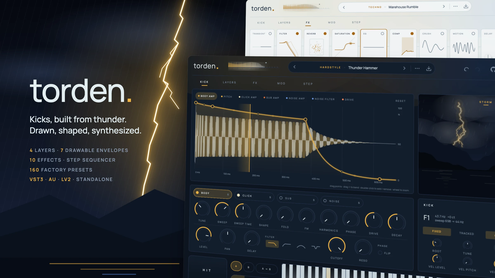
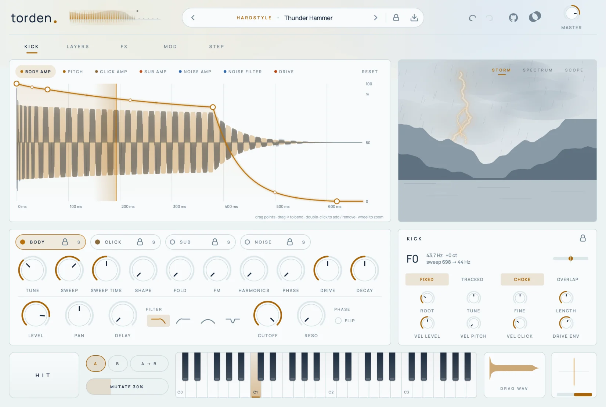
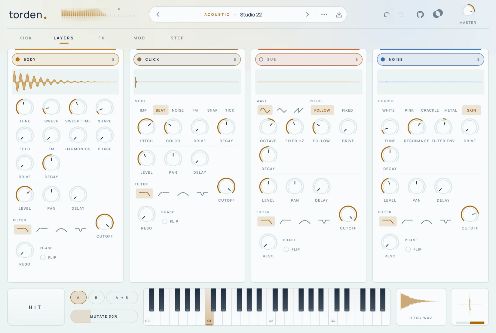
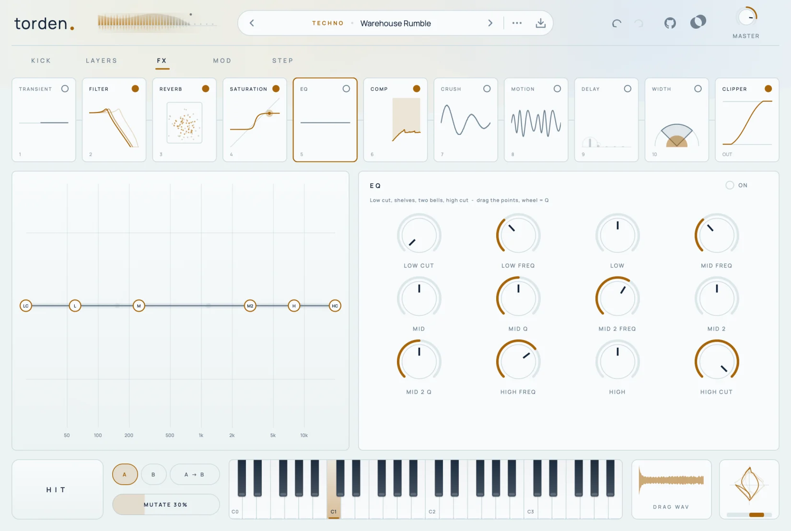
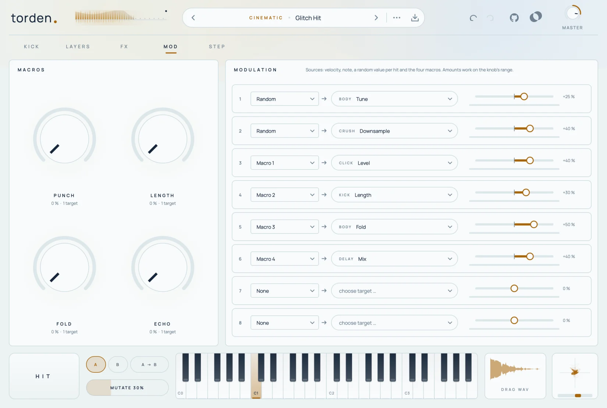
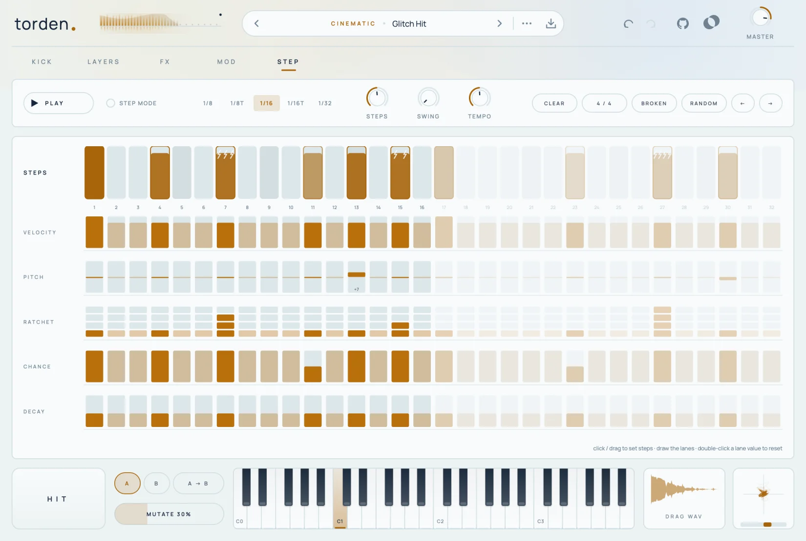

<picture>
  <source media="(prefers-color-scheme: dark)" srcset="docs/screenshots/hero-dark.webp">
  
</picture>

# Torden

A kick drum synthesizer for every common DAW – VST3, Audio Unit, LV2 and a standalone app. Four layers whose
envelopes you draw directly on the waveform of the kick, ten reorderable effects, a step sequencer, and 220 factory
presets from techno to taiko. *Torden* is Norwegian for thunder; it is the second instrument from Fjord and shares its
Scandinavian, minimal interface (light and dark).

Every sound is synthesized in real time – there are no samples.

[](https://github.com/fjord-sounds/torden/actions/workflows/ci.yml)
[](LICENSE)

> **Made with AI.** Torden – the plugin code, the user interface, the tests and all factory presets – was written
> entirely by AI with Claude Opus, directed by prompts. Nothing is hand-programmed or hand-tuned.
> The code is open so you can read it, test it and judge for yourself; bug reports and pull requests are welcome.

<p>
  <a href="#a-tour">Tour</a> ·
  <a href="#sound-architecture">Sound architecture</a> ·
  <a href="#effects">Effects</a> ·
  <a href="#presets">Presets</a> ·
  <a href="#building">Building</a> ·
  <a href="#tests">Tests</a>
</p>

## Lightweight

- **Small**: the VST3 is about 7 MB (macOS universal binary), including all factory presets and the font.
- **Self-contained**: no sample library, no installer data, no account, no network access.
- **Calm on the audio thread**: no allocations or locks while rendering; envelopes and patterns reach the audio
  thread through lock-free stores.

## Works in your DAW

| Format | Platforms | Hosts (examples) |
|---|---|---|
| **VST3** | macOS, Windows, Linux | Ableton Live, Bitwig Studio, Cubase, FL Studio, Studio One, Reaper, Ardour |
| **AU** | macOS | Logic Pro, GarageBand, MainStage |
| **LV2** | Linux | Ardour, Carla, Qtractor |
| **Standalone** | macOS, Windows, Linux | no DAW needed |

- **Pitch modes**: *Fixed* plays the preset's tuning on every key (the classic drum-rack way), *Tracked* plays the
  kick chromatically around a root note – 808 lines straight from the piano roll.
- **Tempo sync**: the step sequencer and the delay follow the host tempo and song position. With the host stopped,
  the STEP page's Play button runs the pattern at the internal tempo.
- **Any block size and sample rate**: oversized host blocks are split internally; tested at 44.1 to 96 kHz.
- **Presets in the host**: factory presets show up as programs.
- **Automation**: every knob is a host parameter. Envelope shapes and the step pattern are saved with the project and
  in presets.
- **Drag to DAW**: drag the *DRAG WAV* tile from the footer onto a track to get the current kick (with effects) as a
  24-bit WAV at the host sample rate.

## A tour

### Kick

<picture>
  <source media="(prefers-color-scheme: dark)" srcset="docs/screenshots/kick-dark.webp">
  
</picture>

The anatomy of the kick: the rendered waveform with every layer as a coloured band, and the selected envelope on top.
Drag points (shift for fine moves), drag the small diamonds to bend a segment, double-click to add or remove points,
use the mouse wheel to zoom. The pitch envelope shows Hz and note names. A playhead runs across with every hit, and
the waveform morphs smoothly when you change something.

Next to it is the **storm** – every hit is a lightning strike over a fjord, brighter with velocity; switch it to a
**3D spectrum waterfall** (how the fundamental falls with the pitch envelope) or a **scope** with phosphor afterglow.
Below: the selected layer's controls and the kick's global settings with a tuning readout (note, Hz, cents, sweep).

### Layers

<picture>
  <source media="(prefers-color-scheme: dark)" srcset="docs/screenshots/layers-dark.webp">
  
</picture>

All four layers side by side, each with its own waveform, character controls, level, pan, delay (0–20 ms), phase
flip, drive and filter. The dot switches a layer on or off, **S** solos it for listening.

### FX

<picture>
  <source media="(prefers-color-scheme: dark)" srcset="docs/screenshots/fx-dark.webp">
  
</picture>

Ten effects as tiles – drag them into any order. Every tile shows its effect live: the saturation curve with the
signal riding on it, the compressor's gain reduction, reverb particles that fade with the decay, echo rings… The
selected effect opens below with a large graph; the EQ points can be dragged (wheel = Q). The clipper is always last.

### Mod

<picture>
  <source media="(prefers-color-scheme: dark)" srcset="docs/screenshots/mod-dark.webp">
  
</picture>

Four macros (double-click a name to rename it) and an eight-slot matrix. Sources: velocity, note, a random value per
hit, macros 1–4. Any continuous parameter can be a target; amounts work on the knob's range. Hovering a macro lights
up its slots; a live bar shows what each slot is doing right now.

### Step

<picture>
  <source media="(prefers-color-scheme: dark)" srcset="docs/screenshots/step-dark.webp">
  
</picture>

An optional sequencer: up to 32 steps at 1/8, 1/16 or 1/32 (straight or triplet) with swing. Every step has
velocity, pitch (±24 semitones), ratchets (1–4 hits), chance and decay – drawn with the mouse. MIDI notes keep
working alongside. Presets bring a fitting pattern (switch that off in the preset bar's ··· menu).

### Footer

**HIT** plays the kick (higher = harder), **A / B** compares two versions, **MUTATE** creates a random variation
(drag up/down for the amount, right-click to choose the parts), the keyboard plays notes, **DRAG WAV** exports, and
the phase scope shows the stereo image with a correlation meter.

## Sound architecture

| Part | What it does |
|---|---|
| **Body** | The tonal core. Oscillator morphing sine → triangle → saw → square (band-limited), wavefolder, self-FM, 2nd/3rd harmonics, drive. Pitch sweep from *Tune × 2^(Sweep/12)* down to *Tune*, shaped by the pitch envelope (computed per sample). Start phase 0–90°. |
| **Click** | The transient: impulse through a resonant band-pass, beater (fast chirp), noise burst, FM blip, snap, tick. |
| **Sub** | Sine, triangle or warm (saturated) sine; follows the body (octave and a share of its sweep) or a fixed frequency. |
| **Noise** | White, pink, crackle, metallic (tuned comb resonator) or membrane (two drum-skin modes); its own filter envelope. |
| **Every layer** | Amplitude envelope, level, pan, delay, phase flip, drive, state-variable filter (low / high / band / notch). |
| **Envelopes** | Seven multi-point envelopes (up to 12 points, curve per segment): four amplitudes, pitch, noise filter and a drive envelope. Decay knobs and *Length* stretch them. |
| **Kick** | Fixed or tracked pitch, tune, fine, length, velocity to level / pitch depth / click, choke (3 ms fade) or overlap (two hits ring). |
| **Output** | Preset level → effect chain → clipper → master → DC blocker and a last safety stage at −0.3 dBFS. |

## Effects

| Effect | Controls |
|---|---|
| **Saturation** | Tape, tube, diode, fold, hard, rectify; drive, bias, tilt tone, 1× / 2× / 4× oversampling, output, mix |
| **Crush** | Bits, downsampling with jitter, mix |
| **Transient** | Attack and sustain (level independent), speed, output |
| **Compressor** | Threshold, ratio, attack, release, knee, makeup, sidechain high-pass, parallel mix |
| **EQ** | 24 dB low cut, low shelf, two bells, high shelf, 24 dB high cut – interactive graph |
| **Filter** | Ladder or SVF (low / band / high / notch), resonance, drive, an envelope that restarts on every hit |
| **Reverb** | Room, plate or hall (8-line FDN); size, decay, damping, pre-delay, low cut, width, ducking |
| **Delay** | Synced or free, ping-pong, damping and low cut in the feedback, ducking |
| **Motion** | Chorus, phaser or flanger for tails |
| **Width** | Stereo width with everything below the crossover kept mono |
| **Clipper** | Soft, hard or tape up to the ceiling (always last) |

## Presets

220 factory presets in twelve categories: sixteen each in **Techno, House, Hardstyle, Trap, Hip-Hop, DnB, Industrial,
Minimal, Acoustic** (drums modelled from scratch) and **Cinematic**, plus thirty each in **Pop** and **Tropical** – soft,
deep four-on-the-floor kicks that sit under soft synths in a verse. Every preset sets the layers, all seven envelopes, the
effect chain, four named macros and a step pattern, and is loudness matched. User presets are saved to
`~/Music/Fjord/Torden/Presets/<Category>/*.torden` (plain XML) and appear in the browser with tags and favourites.

The factory presets live in [`presets/Factory/`](presets/Factory) and are embedded in the plugin at build time.

## Building

Requirements: CMake 3.22+, a C++20 compiler. JUCE 8 is downloaded by CMake on the first configure (or put a
checkout in `external/JUCE`).

```bash
./build.sh                                     # macOS: AU + VST3 + Standalone, installs them, runs auval
cmake -S . -B build -DCMAKE_BUILD_TYPE=Release -DTORDEN_COPY_PLUGIN=OFF && cmake --build build -j8   # elsewhere
```

## Tests

`TordenRenderTest` renders Torden without a DAW:

```bash
cmake --build build --target TordenRenderTest -j8
./build/TordenRenderTest_artefacts/Release/TordenRenderTest build/renders          # must print ALL PASSED
./build/TordenRenderTest_artefacts/Release/TordenRenderTest build/renders --sr 96000
```

It checks every layer mode, effect and factory preset for NaN, clipping, DC and stuck voices; that retriggering does
not click; the step sequencer's timing (four on the floor, ratchets, swing, chance, internal clock); odd host block
sizes; and that presets, project state and undo bring back parameters, envelopes, patterns and the effect order.
`TORDEN_WAV=1` also writes the renders as WAV files.

More modes: `--single <preset|init> <out.wav> [note]`, `--screenshot <kick|layers|fx|mod|step|browser|about|save>
<preset|init> <light|dark> <out.png> [fx index]`, `--loudness <json>`, `--param-info <tsv>`, `--icon <png>`.
README images: `tools/screenshots/shoot.sh` (page shots, then `hero.mjs` composes the product image with Playwright –
run `npm install` in `tools/screenshots` once).

## Licences

Torden is licensed under the [AGPL-3.0](LICENSE). It uses JUCE (AGPLv3) and the Manrope font (SIL Open Font
License) – see [THIRD_PARTY_NOTICES.md](THIRD_PARTY_NOTICES.md).
